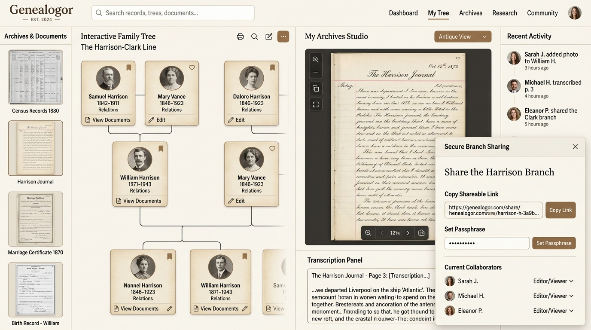

# 🌳 Genealogor — Arbre Familial & Archives Numérisées

<div align="center">



**Application moderne de généalogie collaborative, partage sécurisé par branche et studio d'archives numérisées.**

[](https://www.typescriptlang.org/)
[](https://react.dev/)
[](https://vitejs.dev/)
[](https://tailwindcss.com/)
[](https://firebase.google.com/)
[](LICENSE)

[✨ Fonctionnalités](#-fonctionnalités-phares) • [🏛️ Studio d'Archives](#-studio-darchives-numérisées) • [🔐 Partage & Sécurité](#-partage-sécurisé-par-branche) • [🚀 Démarrage](#-démarrage-rapide) • [📐 Architecture](#-architecture-technique)

</div>

---

## 🌟 Présentation

**Genealogor** est conçu pour les passionnés de généalogie et les familles souhaitant explorer, documenter et transmettre leur histoire commune. 

Alliant l'esthétique soignée d'une publication éditoriale d'archive au dynamisme des outils collaboratifs actuels, Genealogor permet de visualiser les lignées familiales, d'indexer des actes manuscrits anciens, et de partager des branches spécifiques avec vos proches via des **liens privés protégés par mot de passe**, sans imposer la création d'un compte obligatoire à vos cousins.

---

## ✨ Fonctionnalités Phares

### 🌿 1. Visualisation & Navigation dans l'Arbre
- **Multi-vues interactives** :
  - **Vue Arbre classique & Ascendance** : Arbre généalogique hiérarchique avec numérotation **Sosa-Stradonitz** (de cujus = 1, père = 2n, mère = 2n+1).
  - **Descendance & Fratrie** : Visualisation des unions, conjoints multiples et enfants.
  - **Fiche Biographique Individuelle** : Synthèse de vie complète (naissance, baptême, mariage, profession, domicile, décès, sépulture).
  - **Chronologie & Frise Historique** : Mise en perspective des étapes familiales avec les grands repères de l'histoire de France (Révolution, Empire, Guerres mondiales).
  - **Carte Géographique** : Cartographie des migrations et dispersion géographique des ancêtres.
  - **Statistiques Généalogiques** : Âge moyen au mariage, longévité par siècle, répartition des naissances par saison et par patronyme.

### 📜 2. Studio d'Archives Numérisées
- **Importation de documents** : Prise en charge des photographies et scans d'actes (JPEG, PNG, WebP, PDF) par glisser-déposer.
- **Typologie d'actes complète** :
  - Acte de Naissance / Baptême
  - Acte de Mariage / Contrat de mariage notarié
  - Acte de Décès / Sépulture
  - Recensement de population & Fiche matricule militaire
  - Testament, inventaire après décès, titre de propriété
- **Outils d'examen paléographique** :
  - Zoom fluide haute définition et déplacement panoramique.
  - Rotation à 90°, 180° et 270° pour les registres numérisés à l'horizontale.
  - Filtres d'amélioration de lecture : Contraste renforcé et Inversion négative (idéal pour les écritures à l'encre délavée).
- **Convertisseur Calendrier Républicain** :
  - Conversion instantanée des dates du calendrier révolutionnaire français (1792–1805 : *Vendémiaire, Brumaire, Nivôse...*) en grégorien et réciproquement.
- **Rattachement direct** : Association manuelle en un clic de l'acte aux fiches des individus et conjoints concernés.

### 🔐 3. Partage Sécurisé & Accès par Branche
- **Liens privés personnalisés** :
  - Génération d'URLs uniques par branche (**Branche Paternelle**, **Branche Maternelle**, ou **Arbre Complet**).
- **Protection par mot de passe de branche** :
  - Vos cousins saisissent simplement le mot de passe partagé de leur branche pour déverrouiller l'accès.
  - **Aucun compte Gmail requis** : accès immédiat en lecture ou suggestion d'ajouts.
- **Niveaux de permissions granulaires** :
  - 👁️ **Lecteur** : Consultation sécurisée de la branche autorisée.
  - ✏️ **Contributeur / Éditeur** : Capacité d'enrichir les fiches et d'importer de nouveaux actes.
  - 👑 **Administrateur** : Contrôle complet, gestion des mots de passe et export.
- **Protection de la vie privée (RGPD)** :
  - Masquage automatique des personnes vivantes (moins de 100 ans ou sans date de décès confirmée) lors des partages externes.

### ⚡ 4. Collaboration Temps Réel & Synchronisation Hybride
- **Relais WebSocket en direct** : Voyez instantanément les modifications apportées par d'autres membres de la famille connectés simultanément.
- **Indicateur de présence** : Nombre de pairs connectés en direct dans la salle familiale.
- **Local-First & Résilience hors-ligne** : Vos données restent consultables et modifiables même sans connexion Internet, avec mise en file d'attente des changements (`PendingQueue`) et synchronisation automatique lors du retour en ligne.
- **Cloud Firebase Firestore** : Persistance sécurisée des arbres, actes et permissions avec règles de sécurité ABAC zéro-trust.

### 💾 5. Compatibilité GEDCOM & Sauvegardes
- **Import / Export GEDCOM 5.5.1** : Standard universel de la généalogie compatible avec Geneanet, Filae, Heredis, Geneatique, MyHeritage, FamilySearch.
- **Sauvegarde intégrale chiffrée** : Export complet de l'arbre, des archives numérisées et des configurations au format JSON avec somme de contrôle **SHA-256**.
- **Module de fusion intelligente** : Détection automatique des doublons avec comparaison champ par champ (dates, lieux, filiation).

---

## 📐 Architecture Technique

```
┌────────────────────────────────────────────────────────────────────────┐
│                        Navigateur Client (React 19)                    │
│                                                                        │
│   ┌────────────────────┐   ┌───────────────────┐   ┌───────────────┐   │
│   │   Vues Arbre &     │   │ Studio d'Archives │   │  Gestion des  │   │
│   │   Fiches Personnes │   │   & Paléographie  │   │     Accès     │   │
│   └─────────┬──────────┘   └─────────┬─────────┘   └───────┬───────┘   │
│             │                        │                     │           │
│             ▼                        ▼                     ▼           │
│   ┌────────────────────────────────────────────────────────────────┐   │
│   │            Moteur Central & Gestionnaire d'État                │   │
│   │    - Filtre de branche & Anonymisation vivants                 │   │
│   │    - Validateur chronologique & Détection d'anomalies          │   │
│   │    - Moteur cryptographique AES-GCM 256 / PBKDF2               │   │
│   └───────────────┬────────────────────────────┬───────────────────┘   │
└───────────────────┼────────────────────────────┼───────────────────────┘
                    ▼                            ▼
   ┌────────────────────────────────┐   ┌────────────────────────────────┐
   │    Serveur Node.js / Express   │   │     Google Cloud Firestore     │
   │                                │   │                                │
   │  - WebSocket Relay (ws://)     │   │  - Arbres (/trees/{id})        │
   │  - Diffusion en temps réel     │   │  - Archives numérisées         │
   │  - Gestion des présences       │   │  - Règles ABAC Zero-Trust      │
   └────────────────────────────────┘   └────────────────────────────────┘
```

---

## 🛠️ Pile Technologique

| Domaine | Technologie | Rôle |
| :--- | :--- | :--- |
| **Frontend** | React 19 + TypeScript 7 | Interface utilisateur réactive et typage strict |
| **Bundler & Build** | Vite 8 + TSX | Compilation ultra-rapide et middlewares de dev |
| **Design System** | Tailwind CSS 4 + Lucide Icons | Typographie éditoriale, thème parchemin musée (`#FBF9F5`) |
| **Backend & Temps Réel** | Express 4 + ws (WebSockets) | Serveur applicatif et relais de synchronisation pair-à-pair |
| **Persistance Cloud** | Firebase Firestore (SDK v13) | Stockage distribué des arbres généalogiques et actes |
| **Authentification** | Firebase Auth (Google Sign-In) | Connexion administrateur et sécurité des écritures |
| **Cryptographie** | Web Crypto API native | PBKDF2 (100k itérations), AES-GCM 256-bit, SHA-256 |
| **Standard Métier** | GEDCOM 5.5.1 + Calendrier Républicain | Interopérabilité généalogique et archives françaises |

---

## 🚀 Démarrage Rapide

### Prérequis
- Node.js (version 20 ou supérieure recommandée)
- npm ou bun

### Installation
```bash
# 1. Cloner le dépôt
git clone https://github.com/votre-compte/genealogor.git
cd genealogor

# 2. Installer les dépendances
npm install

# 3. Lancer le serveur de développement (Express + Vite + WebSocket sur le port 3000)
npm run dev
```

Ouvrez ensuite votre navigateur sur **`http://localhost:3000`**.

### Scripts Disponibles
- `npm run dev` : Démarre le serveur complet avec Express, WebSockets et Vite.
- `npm run build` : Compile l'application pour la production.
- `npm run start` : Lance l'application en mode production.
- `npm run lint` : Vérifie la validité du typage TypeScript (`tsc --noEmit`).

---

## 🔒 Sécurité & Confidentialité

- **Zero-Trust ABAC** : Les règles Firestore (`firestore.rules`) appliquent un contrôle d'accès basé sur les attributs. Seuls les créateurs et éditeurs déclarés peuvent modifier un arbre.
- **Chiffrement de bout en bout des sauvegardes** : Les archives de sauvegarde exportées peuvent être chiffrées avec votre mot de passe maître via AES-GCM.
- **Protection des mineurs et personnes contemporaines** : L'algorithme masque automatiquement les données sensibles (dates, lieux, notes) des individus nés il y a moins d'un siècle pour les utilisateurs en mode visiteur ou lecteur de branche.

---

## 🤝 Contribution

Les contributions, signalements de bugs et suggestions d'améliorations sont les bienvenus !
1. Forkez le projet
2. Créez votre branche de fonctionnalité (`git checkout -b feature/nouvelle-fonctionnalite`)
3. Committez vos modifications (`git commit -m 'feat: ajout du support des sources notariées'`)
4. Poussez sur votre branche (`git push origin feature/nouvelle-fonctionnalite`)
5. Ouvrez une **Pull Request**

---

<div align="center">
  <sub>Fait avec passion pour la mémoire et la transmission de l'histoire familiale.</sub>
</div>
